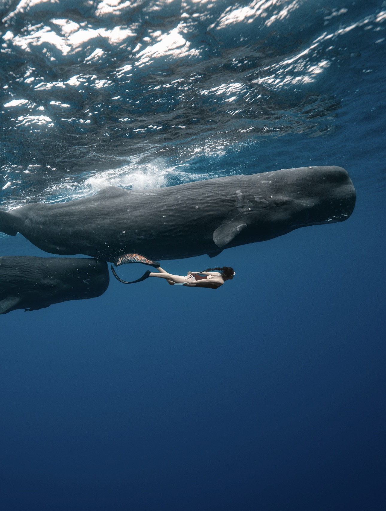

```{r setup, include=FALSE}
knitr::opts_chunk$set(echo = TRUE)
```

## Helloo!


Welcome to my personal website! I'm **Yiman Rui** or Anny, a master's student in Biostatistics at Columbia University Mailman School of Public Health, following the Statistical Genomics track. I earned my B.S. in Statistics from the University of Michigan.

## A little bit about me

My previous research experiences have involved genomic data analysis, tumor phylogeny reconstruction, and clinical research. Through these projects, I have gained experience working with biological and clinical datasets, developing computational workflows, and interpreting statistical results. I am especially interested in how statistical methods can help answer meaningful clinical questions and improve our understanding of disease.

Outside of class, one of my favorite things to do is scuba diving and freediving. I love exploring the underwater world and discovering all the amazing marine life. It's such a different experience from everyday life, and I always look forward to my next dive! 

{width=400px}


## Explore My Website

You can learn more about my background on my [Education and Experience](about.html) page.

This website was created using R Markdown as part of [P8105: Data Science I](https://p8105.com/) at Columbia University.